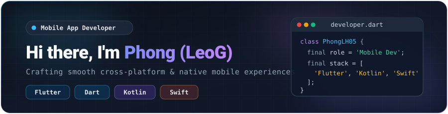

  <!-- Synchronized Tokyo Night Hero Banner -->
  

    

  <!-- Synchronized Tokyo Night Tech Stack & Tools Badges -->
  

    
    
    
    
    
  

  

    
    
    
    
    
    
  

   

  <!-- Unified Tokyo Night GitHub Stats Grid (Same engine, font & palette) -->
  

    
    
  

  

    
  

